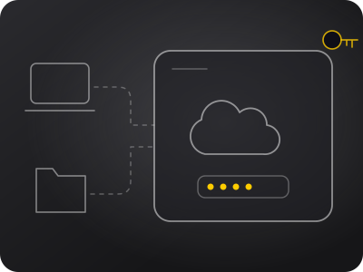
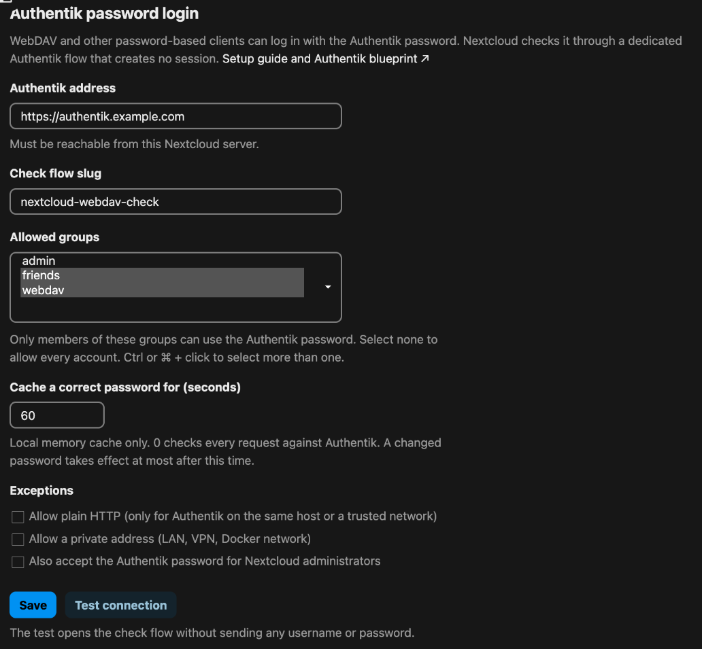
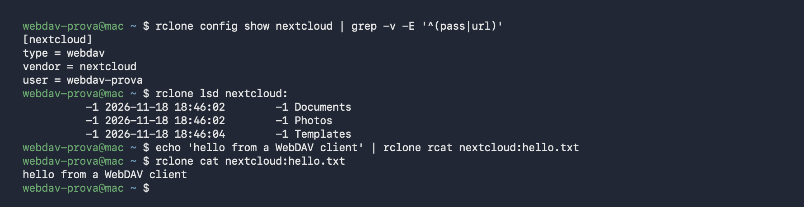
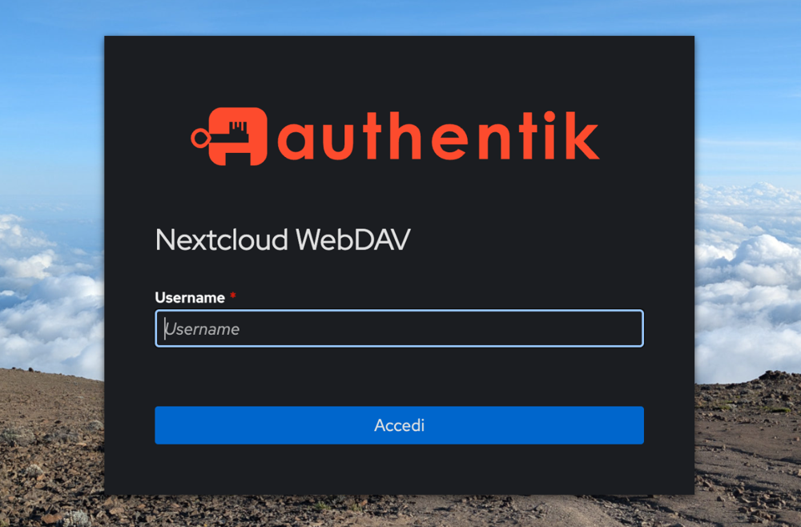
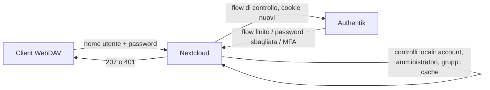

# Accesso con la password di Authentik per Nextcloud

<p align="center"></p>

🇬🇧 [English](README.md) · 🇮🇹 **Italiano**

**Fa entrare i client WebDAV in Nextcloud con la password di Authentik.** Quando gli utenti accedono a Nextcloud tramite Authentik (OpenID Connect), il Finder, Esplora risorse, rclone e gli altri client WebDAV non possono seguire il login dal browser: inviano solo nome utente e password. Questa piccola app per Nextcloud controlla quella password su **Authentik**, tramite un flow dedicato che non crea sessioni, così gli utenti non hanno bisogno di una seconda password.

[](https://github.com/EmaLau/nextcloud-authentik-dav/actions/workflows/ci.yml)
[](https://github.com/EmaLau/nextcloud-authentik-dav/releases)


## Funzionalità

- **La password di Authentik in ogni client WebDAV**: Finder, Esplora risorse, rclone, Cyberduck, file manager di Linux e dei telefoni.
- **Nessun account nuovo e nessuna password conservata**: controlla solo la password di account che esistono già in Nextcloud; Authentik resta l'unico posto dove stanno le password.
- **Blueprint pronto per Authentik**: un solo file crea il flow di controllo e le sue stage (solo nome utente, solo database delle password di Authentik, controllo dell'MFA), con un limite facoltativo ai tentativi falliti per nome utente.
- **Impostazioni sicure per default**: utenti con MFA, amministratori di Nextcloud e utenti fuori dai gruppi ammessi vengono rifiutati; HTTP non cifrato e indirizzi privati vanno consentiti esplicitamente; i tentativi a forza bruta li limita Nextcloud.
- **Pagina di impostazioni** in *Impostazioni di amministrazione → Sicurezza*, con un pulsante **Prova connessione** che non invia password, e un **controllo nella panoramica** di amministrazione.
- **Cache locale breve**: una password giusta resta come hash per 60 secondi, solo nella memoria locale, mai su Redis.
- **Log adatti a fail2ban**: una riga per ogni tentativo rifiutato con utente, indirizzo e motivo, mai la password.
- **Provata da cima a fondo**: test unitari su Nextcloud 30–36 e, a ogni modifica, accessi WebDAV veri contro un Authentik e un Nextcloud veri in Docker.

## Schermate

<p align="center"></p>

<p align="center"><br><sub>rclone che entra con la password di Authentik di un utente di prova (password e indirizzo nascosti)</sub></p>

<p align="center"><br><sub>Il flow di controllo su Authentik: lo stage di identificazione chiede solo il nome utente</sub></p>

## Avvio rapido

1. **Authentik**: applica il blueprint [`authentik/nextcloud-webdav-check.yaml`](authentik/nextcloud-webdav-check.yaml) (*Flows and Stages → Flows → Import*).
2. **Nextcloud**: installa l'app dall'[ultima release](https://github.com/EmaLau/nextcloud-authentik-dav/releases/latest):

   ```bash
   cd /var/www/html/custom_apps
   curl -fsSL https://github.com/EmaLau/nextcloud-authentik-dav/releases/latest/download/authentik_dav.tar.gz | tar -xz
   chown -R www-data:www-data authentik_dav
   occ app:enable authentik_dav
   ```

3. Apri **Impostazioni di amministrazione → Sicurezza → Accesso con la password di Authentik**, inserisci l'indirizzo di Authentik, premi **Prova connessione** e poi **Salva**.
4. Collega un client WebDAV a `https://nextcloud.example.com/remote.php/dav/files/<nomeutente>/` con nome utente e password di Authentik.

Chi ha l'MFA su Authentik o l'autenticazione a due fattori su Nextcloud continua a usare le password per app di Nextcloud. La [documentazione](docs/documentazione.md#installazione) spiega ogni passo nel dettaglio.

## Come funziona



L'app è un **backend utenti solo per le password**: non possiede utenti. Per ogni controllo esegue il flow di Authentik tramite l'API del flow executor (identificazione → password → controllo MFA); la password è accettata solo se il flow arriva in fondo. Il flow non ha lo stage *User login*, quindi non crea mai una sessione. Dettagli: [Come funziona](docs/documentazione.md#come-funziona) e [Sicurezza](docs/documentazione.md#sicurezza).

## Impostazioni

| Chiave | Predefinito | Descrizione |
|---|---|---|
| `base_url` | vuoto (spenta) | Indirizzo di Authentik, come lo vede il server Nextcloud |
| `flow_slug` | `nextcloud-webdav-check` | Slug del flow di controllo |
| `allowed_groups` | vuoto (tutti) | Gruppi di Nextcloud i cui membri possono usare la password di Authentik |
| `cache_ttl` | `60` | Secondi per cui una password giusta resta nella cache in memoria locale (`0` = niente cache) |
| `allow_admins` | `no` | Accetta la password di Authentik anche per gli amministratori di Nextcloud |
| `allow_local_address` | `no` | Consente Authentik su un indirizzo privato (LAN, VPN, rete Docker) |
| `allow_http` | `no` | Consente un indirizzo `http://` non cifrato |

Sono tutte nella pagina delle impostazioni, oppure `occ config:app:set authentik_dav <chiave> --value=...`. Vedi [Impostazioni](docs/documentazione.md#impostazioni).

## Requisiti

- Nextcloud 30–36, PHP 8.1 o successivo, meglio con una cache in memoria locale (APCu).
- Authentik, raggiungibile dal server Nextcloud.
- Un account Nextcloud già esistente per ogni utente, con lo stesso nome utente che ha su Authentik.

## Struttura

```
authentik_dav/     l'app per Nextcloud (PHP e JavaScript semplici, senza build)
authentik/         il blueprint di Authentik
docs/              documentazione completa (inglese e italiano), schermate
dev/               ambiente Docker con Authentik e Nextcloud, test completi
tests/             test PHPUnit con un Authentik simulato
scripts/           archivio di release e firma per lo Store
```

## Sviluppo

```bash
composer install && composer test     # test unitari (anche: composer lint, composer analyse)
docker compose -f dev/compose.yaml --env-file dev/.env up -d --wait && dev/setup.sh && dev/test.sh
```

L'ambiente dei test completi richiede un `dev/.env` copiato da `dev/.env.example`. Tutto è spiegato in [Sviluppo](docs/documentazione.md#sviluppo).

## Contribuire

Segnalazioni, idee e pull request sono benvenute: vedi [CONTRIBUTING.md](CONTRIBUTING.md). I problemi di sicurezza vanno nella [segnalazione privata delle vulnerabilità](SECURITY.md). Le novità tra una versione e l'altra sono in [CHANGELOG.md](CHANGELOG.md), le funzioni previste in [ROADMAP.md](ROADMAP.md).

## Documentazione

La [documentazione completa](docs/documentazione.md) spiega installazione, flow su Authentik, impostazioni, client, sicurezza, prova di connessione, messaggi nel log e problemi comuni, aggiornamenti, struttura del codice, sviluppo e domande frequenti. È disponibile anche in inglese: [`documentation.md`](docs/documentation.md).

## Licenza

[GNU Affero General Public License v3.0](LICENSE). Puoi usare, modificare e ridistribuire l'app. Se la modifichi e la offri come servizio in rete, devi rendere disponibile anche il codice sorgente delle tue modifiche.
