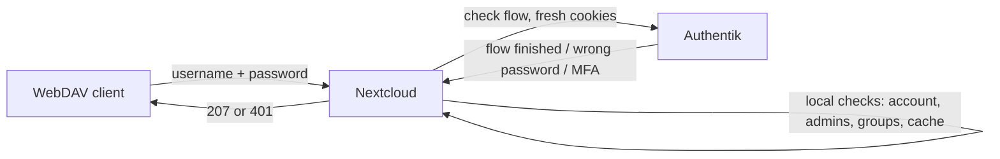

# Authentik password login for Nextcloud

<p align="center"></p>

🇬🇧 **English** · 🇮🇹 [Italiano](README.it.md)

**Let WebDAV clients log in to Nextcloud with the Authentik password.** When Nextcloud users log in through Authentik (OpenID Connect), the Finder, Windows Explorer, rclone and other WebDAV clients cannot follow the browser login: they only send a username and a password. This small Nextcloud app checks that password against **Authentik**, through a dedicated flow that creates no session, so users do not need a second password.

[](https://github.com/EmaLau/nextcloud-authentik-dav/actions/workflows/ci.yml)
[](https://github.com/EmaLau/nextcloud-authentik-dav/releases)


## Features

- **The Authentik password in every WebDAV client**: Finder, Windows Explorer, rclone, Cyberduck, Linux and mobile file managers.
- **No new accounts and no stored passwords**: it only checks the password of accounts that already exist in Nextcloud; Authentik stays the only place where passwords live.
- **Ready-made Authentik blueprint**: one file creates the check flow and its own stages (username only, built-in password database only, MFA check), with an optional limit on failed attempts per username.
- **Safe defaults**: users with MFA, Nextcloud administrators and users outside the allowed groups are refused; plain HTTP and private addresses must be allowed explicitly; brute force is throttled by Nextcloud.
- **Settings page** in *Administration settings → Security*, with a **Test connection** button that sends no password, and a **setup check** in the admin overview.
- **Short local cache**: a correct password is kept as a hash for 60 seconds in local memory only, never in Redis.
- **Logs for fail2ban**: one line per refused attempt with user, address and reason, never the password.
- **Tested end to end**: unit tests on Nextcloud 30–36 and, at every push, real WebDAV logins against a real Authentik and Nextcloud in Docker.

## Screenshots

<p align="center"></p>

<p align="center"><br><sub>rclone logging in with the Authentik password of a test user (password and URL hidden)</sub></p>

<p align="center"><br><sub>The check flow in Authentik: its identification stage asks for the username only</sub></p>

## Quick start

1. **Authentik**: apply the blueprint [`authentik/nextcloud-webdav-check.yaml`](authentik/nextcloud-webdav-check.yaml) (*Flows and Stages → Flows → Import*).
2. **Nextcloud**: install the app from the [latest release](https://github.com/EmaLau/nextcloud-authentik-dav/releases/latest):

   ```bash
   cd /var/www/html/custom_apps
   curl -fsSL https://github.com/EmaLau/nextcloud-authentik-dav/releases/latest/download/authentik_dav.tar.gz | tar -xz
   chown -R www-data:www-data authentik_dav
   occ app:enable authentik_dav
   ```

3. Open **Administration settings → Security → Authentik password login**, enter the Authentik address, press **Test connection**, then **Save**.
4. Connect a WebDAV client to `https://nextcloud.example.com/remote.php/dav/files/<username>/` with the Authentik username and password.

Users with MFA in Authentik or two-factor authentication in Nextcloud keep using Nextcloud app passwords. The [documentation](docs/documentation.md#installation) has every step in detail.

## How it works



The app is a **password-only user backend**: it owns no users. For each check it runs the Authentik flow through the flow executor API (identification → password → MFA check); the password is accepted only if the flow finishes. The flow has no *User login* stage, so it never creates a session. Details: [How it works](docs/documentation.md#how-it-works) and [Security](docs/documentation.md#security).

## Settings

| Key | Default | Description |
|---|---|---|
| `base_url` | empty (off) | Authentik address, as seen from the Nextcloud server |
| `flow_slug` | `nextcloud-webdav-check` | Slug of the check flow |
| `allowed_groups` | empty (everyone) | Nextcloud groups whose members may use the Authentik password |
| `cache_ttl` | `60` | Seconds a correct password stays in the local memory cache (`0` = no cache) |
| `allow_admins` | `no` | Accept the Authentik password for Nextcloud administrators too |
| `allow_local_address` | `no` | Allow Authentik on a private address (LAN, VPN, Docker network) |
| `allow_http` | `no` | Allow a plain `http://` address |

All of them are on the settings page, or `occ config:app:set authentik_dav <key> --value=...`. See [Settings](docs/documentation.md#settings).

## Requirements

- Nextcloud 30–36, PHP 8.1 or later, ideally with a local memory cache (APCu).
- Authentik, reachable from the Nextcloud server.
- An existing Nextcloud account for every user, with the same username as in Authentik.

## Project layout

```
authentik_dav/     the Nextcloud app (plain PHP and JavaScript, no build step)
authentik/         the Authentik blueprint
docs/              full documentation (English and Italian), screenshots
dev/               Docker environment with Authentik and Nextcloud, end-to-end tests
tests/             PHPUnit tests with a simulated Authentik
scripts/           release archive and App Store signature
```

## Development

```bash
composer install && composer test     # unit tests (also: composer lint, composer analyse)
docker compose -f dev/compose.yaml --env-file dev/.env up -d --wait && dev/setup.sh && dev/test.sh
```

The end-to-end environment needs a `dev/.env` copied from `dev/.env.example`. Everything is explained in [Development](docs/documentation.md#development).

## Contributing

Bug reports, ideas and pull requests are welcome: see [CONTRIBUTING.md](CONTRIBUTING.md). Security problems go to the [private vulnerability reporting](SECURITY.md). Changes between versions are in [CHANGELOG.md](CHANGELOG.md), planned features in [ROADMAP.md](ROADMAP.md).

## Documentation

The [full documentation](docs/documentation.md) covers installation, the Authentik flow, settings, clients, security, the connection test, log messages and troubleshooting, updating, internals, development and FAQ. It is also available in Italian: [`documentazione.md`](docs/documentazione.md).

## License

[GNU Affero General Public License v3.0](LICENSE). You are free to use, modify and redistribute the app. If you modify it and offer it as a network service, you must also make the source code of your changes available.
