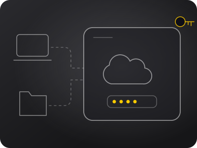
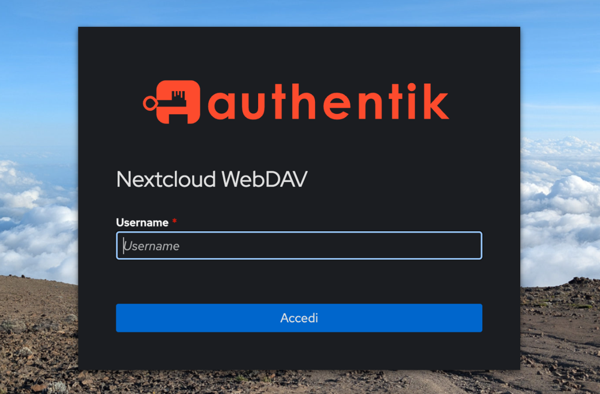
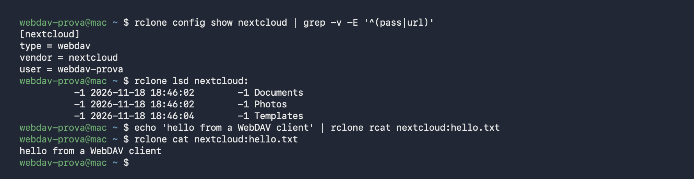
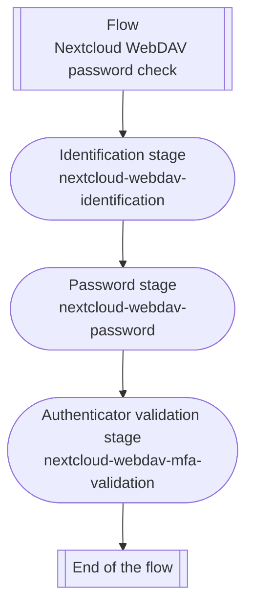
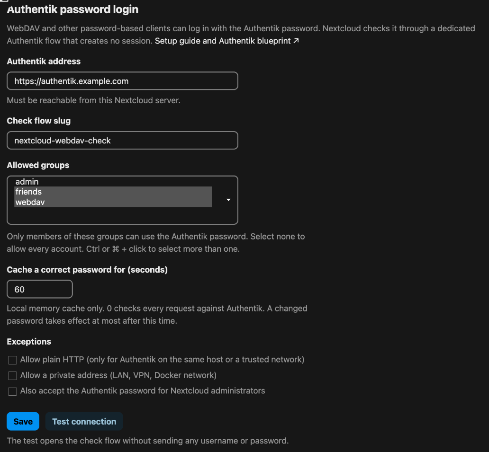

# Authentik password login for Nextcloud WebDAV

[](https://github.com/EmaLau/nextcloud-authentik-dav/actions/workflows/ci.yml)

<p align="center"></p>

> **Version 1.1.** It runs on one homelab (Nextcloud 35, Authentik 2026.8) and went through a security review of the code and of the Authentik flow. What changed: [CHANGELOG](CHANGELOG.md); what comes next: [roadmap](ROADMAP.md).

When Nextcloud users log in through **Authentik** (OpenID Connect), the web login works, but WebDAV clients (Finder, Windows Explorer, rclone, file managers) cannot do the OIDC dance: they only send a username and a password. Users then need a separate Nextcloud app password, or a second local password.

This small Nextcloud app lets WebDAV and other password-based clients use the **Authentik password** instead. Nextcloud asks Authentik whether the password is right, through a dedicated Authentik flow that creates no session.

## How it works

- It is a **password-only user backend**: it owns no users. Accounts stay in Nextcloud's database backend, and the app only answers "is this the right password for this existing account?".
- For each check it runs a dedicated Authentik flow through the flow executor API: identification stage → password stage → MFA check. The password is accepted only if the flow finishes.
- If the user has MFA configured in Authentik, the flow asks for the second factor, and the check **fails**: those users keep using Nextcloud app passwords for WebDAV.
- If the user has two-factor authentication enabled **in Nextcloud**, Nextcloud itself refuses every password login from clients, whatever the backend: those users need Nextcloud app passwords too.
- Nextcloud administrators are excluded by default. Optionally, only members of chosen Nextcloud groups can use the Authentik password.
- A correct password is cached (as a `password_hash`) for 60 seconds by default, so a WebDAV client does not hit Authentik at every request. The cache is **local to the server** (APCu): nothing derived from the password is stored in Redis or Memcached. Without a local memory cache configured, every request is checked against Authentik. A password change in Authentik takes effect at most after the cache time.

## Screenshots

The check flow in Authentik, with its own identification stage (username only):

<p align="center"></p>

rclone, a WebDAV client, logging in to Nextcloud with the Authentik password of a test user (password and URL hidden):

<p align="center"></p>

The flow, as Authentik draws it:



## Security notes

- **Brute force**: failed attempts are throttled by Nextcloud's own brute-force protection. Every client login goes through `OC\User\Session::logClientIn()`, which slows down and then blocks an IP address after repeated failures, for all user backends.
- **Failed attempts are logged** at warning level, with user, client address and reason, never the password:
  `authentik_dav: login failed for user 'alice' from '192.0.2.10': wrong password`.
  Nextcloud also logs its own `Login failed: 'alice' (Remote IP: '192.0.2.10')` line, which fail2ban filters for Nextcloud already match.
- **Plain HTTP is refused**: `base_url` must use `https://`, unless `allow_http=yes` is set (only for Authentik on the same host or a trusted network).
- **Local addresses are refused** by Nextcloud's HTTP client unless `allow_local_address=yes`: set it only when Authentik runs on a private address.
- The check flow must only check the password. Each check uses a fresh cookie jar that is thrown away, so even a session created by mistake is never reused.

## Requirements

- Nextcloud 30–36 (tested against the public API of 30, 31, 35 and the development branch of 36), PHP 8.1 or later.
- Authentik, reachable **from the Nextcloud server**.
- An existing Nextcloud account for every user (for example created in advance, or provisioned by `user_oidc` at the first web login).

## Installation

### 1. The Authentik flow

The repository includes an **Authentik blueprint**, [`authentik/nextcloud-webdav-check.yaml`](authentik/nextcloud-webdav-check.yaml), that creates the check flow and three stages used only by it:

| Stage | Setting |
|---|---|
| Identification | user fields: *username* only (not the email), never shows the matched user |
| Password | backend: the built-in user database only (no app-password tokens, no LDAP or Kerberos) |
| Authenticator validation | users without MFA pass, users with MFA are refused; the MFA is never "remembered" (threshold `seconds=0`) |

There is no *User login* stage: the flow never creates a session. The stages are not shared with the web login, so a change there (for example "remember MFA for 12 hours") does not open WebDAV to users with MFA.

Apply it once, in one of these ways:

- **Admin interface**: *Flows and Stages → Flows → Import*, then choose the file; or *Customization → Blueprints → Create*, paste the file content, save and *Apply*;
- **Command line**: copy it to `/blueprints/custom/` in the worker container and run
  `ak apply_blueprint /blueprints/custom/nextcloud-webdav-check.yaml`.

Applying it again resets the flow and its stages to these settings. To use another slug, change `flow_slug` in the file; the stage names follow it.

<details>
<summary>Building the flow by hand instead</summary>

Create a flow (designation *Authentication*) with an Identification stage (username only), a Password stage (built-in database only) and an Authenticator validation stage (not configured action *skip*, threshold `seconds=0`), with stages of its own and no User login stage.
</details>

### 2. The Nextcloud app

```bash
cp -r authentik_dav /var/www/html/custom_apps/
chown -R www-data:www-data /var/www/html/custom_apps/authentik_dav
occ app:enable authentik_dav
```

With Docker: `docker exec -u 33 <nextcloud-container> php occ ...`.

Then open **Administration settings → Security → Authentik password login**, enter the Authentik address and press **Test connection**: it opens the check flow without sending any username or password, and tells you if Authentik cannot be reached, the flow does not exist or its first stage is not right. The **Overview** page runs the same check and warns when something is wrong.

<p align="center"></p>

### 3. Try it

```bash
curl -u alice:'her-authentik-password' -X PROPFIND \
  https://nextcloud.example.com/remote.php/dav/files/alice/ -H 'Depth: 0'
```

## Settings

Everything can be set on the settings page or with `occ config:app:set authentik_dav <key> --value=...`.

| Key | Default | Description |
|---|---|---|
| `base_url` | — (required) | Authentik base URL, as seen from the Nextcloud server |
| `flow_slug` | `nextcloud-webdav-check` | Slug of the check flow |
| `allowed_groups` | empty (everyone) | Nextcloud groups whose members may use the Authentik password, as a JSON list (`["friends","webdav"]`) or comma-separated |
| `cache_ttl` | `60` | Seconds a correct password stays cached in the local memory cache (`0` disables the cache). Changing the address, the flow or an exception invalidates cached passwords at once |
| `allow_admins` | `no` | `yes` to accept Authentik passwords for Nextcloud admins too |
| `allow_local_address` | `no` | `yes` when Authentik is on a private address (LAN, Docker network) |
| `allow_http` | `no` | `yes` to allow a plain-HTTP `base_url` (not recommended) |

Nextcloud keeps app settings in a memory cache for a few seconds, so a change made with `occ` can take up to about 3 seconds to apply.

Disable the app: `occ app:disable authentik_dav`.

## Development

The app has no runtime dependencies. Composer is used only for the tests.

**Unit tests** run against Nextcloud's public API stubs (`nextcloud/ocp`) and a simulated Authentik: no network and no Nextcloud instance needed.

```bash
composer install
composer test      # PHPUnit
composer lint      # php -l on every file
composer analyse   # PHPStan, level 6
```

Without PHP on the machine: `docker run --rm -v "$PWD:/app" -w /app composer:2 sh -c 'composer install && composer test'`.

**End-to-end tests** start a real Authentik and a real Nextcloud with Docker, apply the blueprint, create test users (one without MFA, one with MFA, one outside the allowed groups) and make real WebDAV requests:

```bash
cp dev/.env.example dev/.env          # put random values in it
docker compose -f dev/compose.yaml --env-file dev/.env up -d --wait
dev/setup.sh
dev/test.sh
# Nextcloud: http://localhost:8088 · Authentik: http://localhost:9088
docker compose -f dev/compose.yaml --env-file dev/.env down -v   # delete everything
```

GitHub Actions runs the unit tests against the API of Nextcloud 30, 31, 35 and master (PHP 8.1–8.4), validates `info.xml` against the App Store schema, and runs the end-to-end tests with Authentik 2026.8 and Nextcloud 31 and 35.

**Releases**: `scripts/release.sh` builds `dist/authentik_dav-<version>.tar.gz` and prints the App Store signature; with `NC_CONTAINER=<a Nextcloud container>` it also signs the code. The private key stays outside the repository.

## Roadmap

What is missing before the first public release, and the features planned after it, are in [ROADMAP.md](ROADMAP.md).

## License

[GNU Affero General Public License v3.0](LICENSE), as declared in `appinfo/info.xml`.
